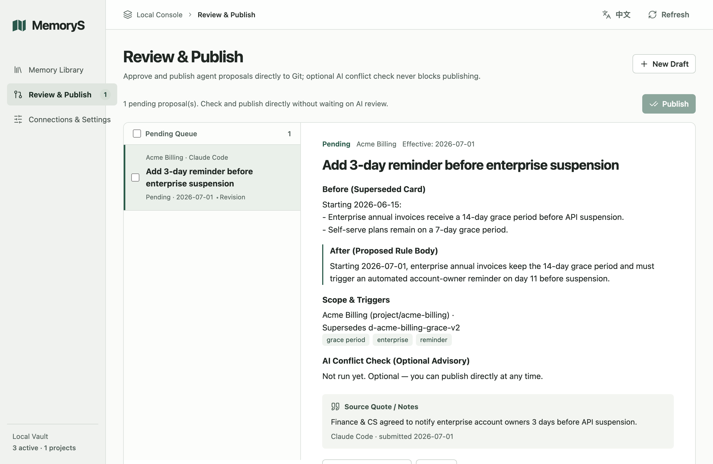

# MemoryS

**Local-first, human-governed memory for AI coding agents.**  
Built on plain Markdown (Obsidian-compatible) + Git + Stdio MCP + `<50ms` local Hooks — with **zero Python runtime dependencies**.

English | [简体中文](README.zh-CN.md)

---

## Why MemoryS?

Most AI agent memory tools optimize for *automatic* capture. Over time, agents silently record guesses, keep stale decisions alive, or mix rules across projects.

MemoryS takes a different stance: **agents propose, humans publish.**

```text
  Claude Code / Codex / Cursor / Any MCP Client
        │                                 ▲
        │ memory_propose (draft only)     │ <50ms recall hook & read-only MCP
        ▼                                 │ (memory_search / read / trace)
  ┌─────────────────────┐        ┌──────────────────────────┐
  │ SQLite Review Queue │        │  Obsidian Vault + Git    │
  │ (secret & policy    │───────▶│  (Single Source of Truth)│
  │  guard built-in)    │ Human  │  • YAML frontmatter      │
  └─────────────────────┘ Publish│  • supersedes / as_of    │
                          Gate   │  • SOURCES.md provenance │
                                 └──────────────────────────┘
```

### What Makes It Different

| Capability | MemoryS | Auto-Capture Plugins | Hosted Vector Memory |
|---|---|---|---|
| **Human publish gate** | Agents can only queue drafts; vault writes require explicit confirmation + Git commit | Writes automatically | Writes automatically |
| **Temporal rules (`as_of`)** | Native `effective_from` / `effective_until` & `supersedes` chains | Rarely supported | Limited |
| **Quote provenance (`trace`)** | Every rule can link back to verbatim quotes in `SOURCES.md` | Opaque summaries | Chunk snippets |
| **Zero-dependency local recall** | Pure Python stdlib, `<50ms` `UserPromptSubmit` hook, no Docker / vector DB | Often requires LLM calls | Cloud or local DB |
| **Cross-client shared brain** | One Git/Obsidian vault shared across Claude Code, Codex, Cursor, etc. | Usually single-client | SDK-coupled |
| **Review Console** | Native macOS app (Swift + WKWebView + Keychain) + cross-platform local Web UI | CLI / web only | Cloud dashboard |

## Console Preview

**Memory Library** — browse active & historical cards, supersession chains, and source quotes:


**Review & Publish** — inspect agent proposals side-by-side before writing to your vault and committing to Git:



---

## Quick Start (2 Minutes)

Requires **Python 3.10+** and **Git**. No pip packages required for the runtime.

### 1. Install CLI & Initialize a Demo Vault

```bash
git clone https://github.com/52Rain/MemoryS.git
cd MemoryS
pip install -e .

# Create a Git-backed Obsidian vault with sample temporal rules
mem init ~/MemoryS --demo
```

*(You can also run directly without `pip install` via `python3 runtime/memory_cli.py ...`.)*

### 2. Try Point-in-Time (`as_of`) Recall & Provenance

The demo vault includes a billing rule that changed on `2026-06-15`:

```bash
# What was the active rule on May 1, 2026? -> returns v1 (7 days)
mem search --project acme-billing --as-of 2026-05-01

# What is active after June 15, 2026? -> returns v2 (Enterprise 14 days)
mem search --project acme-billing --as-of 2026-07-01

# Trace the verbatim quote behind v2
mem trace d-acme-billing-grace-v2
```

### 3. Connect Your AI Agents (Claude Code / Codex / Cursor)

Preview the exact MCP & Hook configuration first, or add `--apply` to write with `.bak` backups:

```bash
mem connect claude            # preview config snippets
mem connect claude --apply    # write ~/.claude.json & ~/.claude/settings.json

mem connect codex --apply     # write ~/.codex/config.toml & ~/.codex/hooks.json
mem connect cursor --apply    # write ~/.cursor/mcp.json
```

### 4. Launch the Review & Library Console

**Cross-platform Web UI (Linux / Windows / macOS):**

```bash
cd desktop-app && npm ci && npm run build && cd ..
mem ui
```

**Native macOS App (Swift + WKWebView + Keychain, no Electron):**

```bash
cd desktop-app
npm ci
npm run package
open build.noindex/MemoryS.app
```

---

## Core Concepts

### Vault Layout (Obsidian-Ready)

```text
~/MemoryS/
├── START.md                        # Vault entry point
├── PROJECTS.md                     # Auto-generated project index
├── SOURCES.md                      # Append-only JSONL provenance quotes
├── notes/
│   ├── preferences/                # Always-on personal preferences
│   ├── methods/                    # Cross-project reusable playbooks
│   └── domain/                     # Domain knowledge
└── projects/
    └── acme-billing/
        ├── START.md                # Project aliases & local workspace paths
        ├── handoff.md              # Current work-in-progress handoff
        └── d-acme-billing-*.md     # Versioned project decisions
```

### Dual-Layer Local Recall (`recall_hook.py`)

On every prompt (`UserPromptSubmit`), MemoryS runs purely locally in `<50ms`:
1. **Layer 1 — Personal Preferences**: Active cards under `shared/preferences` (budget-capped).
2. **Layer 2a — Dual-Path Project Matching**: Matches projects by current working directory (`cwd` against `paths`) **or** by mentioning the project title/alias in the prompt text — even from an unrelated directory.
3. **Layer 2b — Relevant Shared Methods & Domain Knowledge**: Keyword-scored active cards under `shared/methods` and `shared/domain`.

### MCP Tools (`mcp_server.py`)

- `memory_search(query, project, scope, as_of, include_history)` — Read-only search with temporal filtering.
- `memory_read(card_id)` — Full card metadata, body, and `supersedes` / `superseded_by` chain.
- `memory_trace(card_id)` — Resolve `source_refs` against `SOURCES.md`.
- `memory_propose(scope, title, body, effective_from, supersedes, quote, use_when, client)` — Queue a draft proposal for human approval. Built-in guards reject API keys, private keys, and `"do not record"` directives.

### Optional AI Conflict Check

In the Review Console, you can optionally configure any OpenAI Chat Completions compatible endpoint to check a pending proposal against active cards in the same scope. **It is purely advisory and never blocks publishing.**

---

## Configuration & Environment Variables

Vault resolution priority:
1. `--vault <path>` CLI flag
2. `MEMORYS_VAULT` environment variable
3. `~/.config/memorys/config.json` (`vault_path`, set automatically by `mem init`)
4. `~/MemoryS` (if present)

Other environment variables:
- `MEMORYS_APP_DATA`: Override SQLite queue directory (defaults to OS standard app data path).
- `MEMORYS_API_KEY`: Optional API key for Web UI AI conflict checks (macOS App uses Keychain).

---

## Development & Testing

```bash
# Run full unit & integration test suite (pure Python stdlib)
python3 -B -m unittest discover -v -s tests

# Build frontend console
cd desktop-app && npm ci && npm run build
```

See [CONTRIBUTING.md](CONTRIBUTING.md) and [SECURITY.md](SECURITY.md) for contribution guidelines and security model details.

## License

[MIT](LICENSE)
