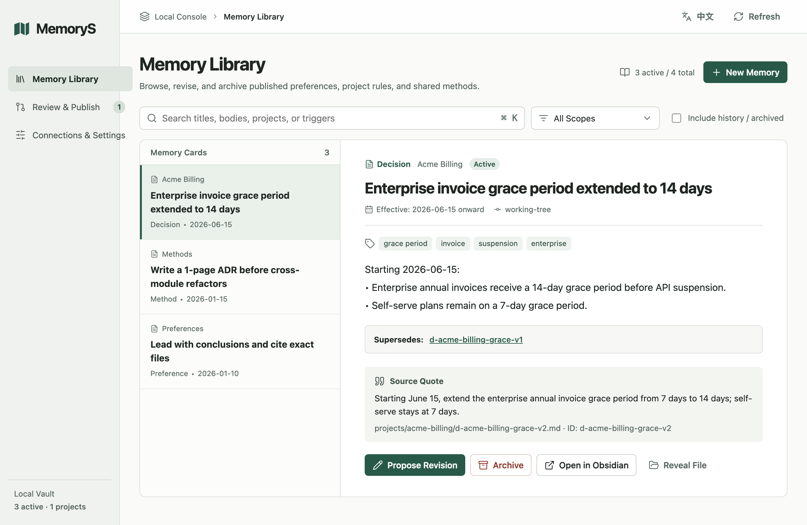

# MemoryS

**Local-first, human-governed memory for AI coding agents.**  
Built on plain Markdown (Obsidian-compatible) + Git + Stdio MCP + `<50ms` local Hooks — with **zero Python runtime dependencies**.

English | [简体中文](README.zh-CN.md)

---

## Why MemoryS?

Most AI agent memory tools optimize for *automatic* capture. Over time, agents silently record guesses, keep stale decisions alive, or mix rules across projects.

MemoryS takes a different stance: **agents propose, humans publish.**

```text
  Claude Code / Codex / Cursor / Any MCP Client
        │                                 ▲
        │ memory_propose (draft only)     │ <50ms recall hook & read-only MCP
        ▼                                 │ (memory_search / read / trace)
  ┌─────────────────────┐        ┌──────────────────────────┐
  │ SQLite Review Queue │        │  Obsidian Vault + Git    │
  │ (secret & policy    │───────▶│  (Single Source of Truth)│
  │  guard built-in)    │ Human  │  • YAML frontmatter      │
  └─────────────────────┘ Publish│  • supersedes / as_of    │
                          Gate   │  • SOURCES.md provenance │
                                 └──────────────────────────┘
```

### What Makes It Different

| Capability | MemoryS | Auto-Capture Plugins | Hosted Vector Memory |
|---|---|---|---|
| **Human publish gate** | MCP tools read published cards and queue drafts for human review and Git-backed publication | Writes automatically | Writes automatically |
| **Temporal rules (`as_of`)** | Native `effective_from` / `effective_until` & `supersedes` chains | Rarely supported | Limited |
| **Quote provenance (`trace`)** | Every rule can link back to verbatim quotes in `SOURCES.md` | Opaque summaries | Chunk snippets |
| **Zero-dependency local recall** | Pure Python stdlib, `<50ms` `UserPromptSubmit` hook, no Docker / vector DB | Often requires LLM calls | Cloud or local DB |
| **Cross-client shared brain** | One Git/Obsidian vault shared across Claude Code, Codex, Cursor, etc. | Usually single-client | SDK-coupled |
| **Review Console** | Native macOS app (Swift + WKWebView + Keychain) + cross-platform local Web UI | CLI / web only | Cloud dashboard |

## Console Preview

**Memory Library** — browse active & historical cards, supersession chains, and source quotes:



**Review & Publish** — inspect agent proposals side-by-side before writing to your vault and committing to Git:


---

## Quick Start (2 Minutes)

Install **Python 3.10+** and **Git**. Keep the source checkout and vault in separate directories. The default vault is `~/memorys-vault` on all platforms.

### 1. Install CLI & Initialize a Demo Vault

```bash
git clone https://github.com/52Rain/MemoryS.git
cd MemoryS
python -m venv .venv
# macOS / Linux
source .venv/bin/activate
# Windows PowerShell: .\.venv\Scripts\Activate.ps1
python -m pip install .

# Create a Git-backed Obsidian vault with sample temporal rules
mem init --demo
```

Use `python3` or `py -3` to create the venv if that is your Python 3 launcher. A normal install builds a wheel and copies the runtime, demo vault and web console into the environment. To install a prebuilt wheel, pass its path to `python -m pip install`. For development, `python -m pip install -e .` uses the checkout directly. You can also run `python runtime/memory_cli.py ...` from the checkout.

### 2. Try Point-in-Time (`as_of`) Recall & Provenance

The demo vault includes a billing rule that changed on `2026-06-15`:

```bash
# What was the active rule on May 1, 2026? -> returns v1 (7 days)
mem search --project acme-billing --as-of 2026-05-01

# What is active after June 15, 2026? -> returns v2 (Enterprise 14 days)
mem search --project acme-billing --as-of 2026-07-01

# Trace the verbatim quote behind v2
mem trace d-acme-billing-grace-v2
```

### 3. Connect Your AI Agents (Claude Code / Codex / Cursor)

Preview the exact MCP & Hook configuration first, or add `--apply` to write with `.bak` backups:

```bash
mem connect claude            # preview config snippets
mem connect claude --apply    # write ~/.claude.json & ~/.claude/settings.json

mem connect codex --apply     # write ~/.codex/config.toml & ~/.codex/hooks.json
mem connect cursor --apply    # write ~/.cursor/mcp.json
```

### 4. Launch the Review & Library Console

**Cross-platform Web UI (Linux / Windows / macOS):**

```bash
mem ui
```

The wheel includes the HTML, JavaScript and CSS. To use a different local build, run `mem ui --ui-dir /path/to/dist`. In web mode, type the vault path in settings. Opening a card in Obsidian requires the Obsidian URL handler. Linux uses `xdg-open` for external opens.

**Native macOS app** (macOS 13+, Swift command-line tools, Python 3.10+ available as `python3` and Node.js 22+, version 22.12 or later). Its WKWebView shell uses macOS Keychain and a native directory picker. `App.swift` is 235 lines and the separate icon generator is 15 lines. On Linux and Windows, use the web console.

```bash
cd desktop-app
npm ci
npm run package
open build.noindex/MemoryS.app
```

---

## Core Concepts

### Vault Layout (Obsidian-Ready)

```text
~/memorys-vault/
├── START.md                        # Vault entry point
├── PROJECTS.md                     # Auto-generated project index
├── SOURCES.md                      # Append-only JSONL provenance quotes
├── notes/
│   ├── preferences/                # Always-on personal preferences
│   ├── methods/                    # Cross-project reusable playbooks
│   └── domain/                     # Domain knowledge
└── projects/
    └── acme-billing/
        ├── START.md                # Project aliases & local workspace paths
        ├── handoff.md              # Current work-in-progress handoff
        └── d-acme-billing-*.md     # Versioned project decisions
```

Existing Chinese vaults can keep `项目索引.md` and `来源记录.md`. Legacy proposal states such as `待确认`, `已发布`, `已忽略` and `受限` are recognized.

### Dual-Layer Local Recall (`recall_hook.py`)

On every prompt (`UserPromptSubmit`), MemoryS runs purely locally in `<50ms`:
1. **Layer 1 — Personal Preferences**: Active cards under `shared/preferences` (budget-capped).
2. **Layer 2a — Dual-Path Project Matching**: Matches projects by current working directory (`cwd` against `paths`) **or** by mentioning the project title/alias in the prompt text — even from an unrelated directory.
3. **Layer 2b — Relevant Shared Methods & Domain Knowledge**: Keyword-scored active cards under `shared/methods` and `shared/domain`.

### MCP Tools (`mcp_server.py`)

- `memory_search(query, project, scope, as_of, include_history)` — Read-only search with temporal filtering.
- `memory_read(card_id)` — Full card metadata, body, and `supersedes` / `superseded_by` chain.
- `memory_trace(card_id)` — Resolve `source_refs` against `SOURCES.md`.
- `memory_propose(scope, title, body, effective_from, supersedes, quote, use_when, client)` — Queue a draft proposal for human approval. Built-in guards reject API keys, private keys, and `"do not record"` directives.

**MCP tool-layer read-only isolation** applies to published vault content. These tools queue proposed changes in SQLite. Programs with filesystem access under your OS account retain their existing permissions.

### Optional AI Conflict Check

In the Review Console, you can optionally configure any OpenAI Chat Completions compatible endpoint to check a pending proposal against active cards in the same scope. The selected endpoint receives the draft and active cards from the same scope. You can publish independently of its opinion.

---

## Configuration & Environment Variables

MemoryS checks these locations in order.

1. The global `mem --vault <path>` option.
2. `MEMORYS_VAULT`.
3. The saved `vault_path` in the MemoryS configuration.
4. An existing vault at `$MEMORYS_PROJECT_ROOT/MemoryS`, if configured.
5. An existing `~/memorys-vault`, then the legacy `~/MemoryS`. Read commands in a checkout can fall back to `examples/demo-vault`.

| Setting | Purpose |
|---|---|
| `MEMORYS_CONFIG_DIR` | Directory for `config.json`. Defaults to `$XDG_CONFIG_HOME/memorys` or `~/.config/memorys` on macOS/Linux and `%APPDATA%\MemoryS` on Windows. |
| `MEMORYS_APP_DATA` | Directory for SQLite and the workspace lock. Defaults to `~/Library/Application Support/MemoryS` on macOS, `$XDG_DATA_HOME/memorys` or `~/.local/share/memorys` on Linux, and `%LOCALAPPDATA%\MemoryS` on Windows. |
| `MEMORYS_UI_DIR` | Directory containing built `app.js` and `app.css`. The CLI option `mem ui --ui-dir` takes precedence. |
| `MEMORYS_API_URL`, `MEMORYS_API_KEY` | Optional web model endpoint and key. The environment key applies to this exact base URL, or to the saved model URL when the variable for the endpoint is unset. |
| `CODEX_HOME` | Overrides `~/.codex` for `mem connect codex --apply`. |

## Development & Testing

Run the Python suite from the checkout. Building the UI requires **Node.js 22+ (22.12 or later)** and npm.

```bash
python -B -m unittest discover -v -s tests
python -B tests/check_install.py
node tests/check_markdown.mjs
cd desktop-app
npm ci
npm run build
```

For a release, copy the rebuilt `dist/app.js` and `dist/app.css` into `runtime/ui/`. The wheel ships these tracked files. CI compares them against a fresh build.

See the contribution guidelines and security model. [Contributing](CONTRIBUTING.md) · [Security](SECURITY.md)

## License

[MIT](LICENSE)
