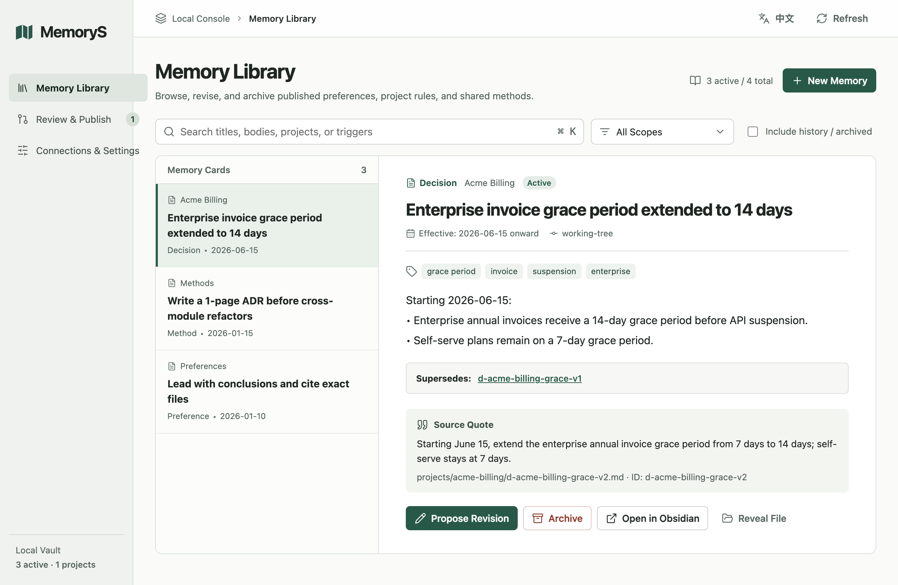
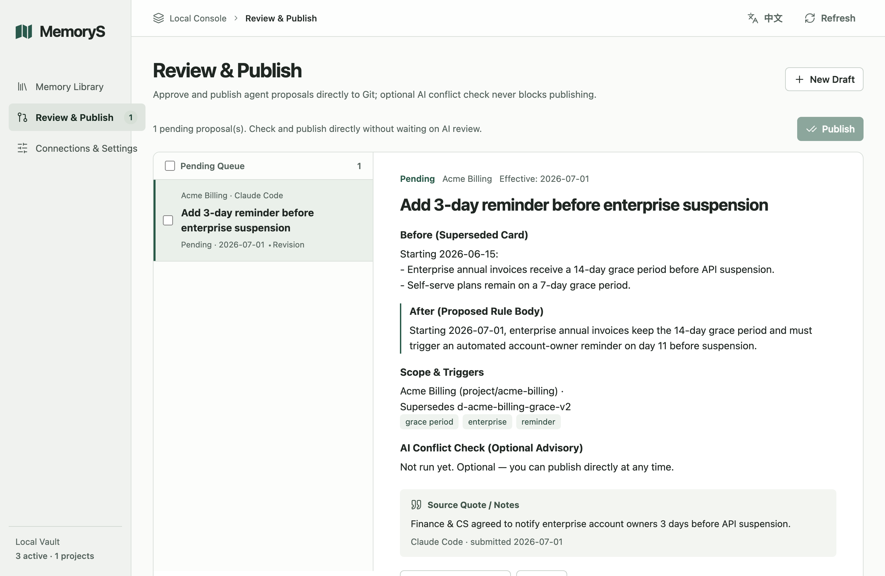

# MemoryS

**本地优先、人工治理的 AI Agent 记忆系统。**  
基于纯 Markdown（原生兼容 Obsidian）+ Git + Stdio MCP + `<50ms` 本地召回 Hook，**Python 运行时零第三方依赖**。

[English](README.md) | 简体中文

---

## 为什么做 MemoryS？

大多数 AI 记忆工具都在追求「全自动记录」。用久了就会遇到三个痛点：AI 偷偷记下臆测、旧规则失效了还在污染新对话、A 项目的业务口径串到 B 项目。

MemoryS 选择一条更克制的路线：**Agent 只能提案，人类确认发布。**

```text
  Claude Code / Codex / Cursor / 任意 MCP 客户端
        │                                 ▲
        │ memory_propose（仅写待审草稿）    │ <50ms 本地 Hook & 只读 MCP
        ▼                                 │ (memory_search / read / trace)
  ┌─────────────────────┐        ┌──────────────────────────┐
  │ SQLite 待审队列      │        │  Obsidian Vault + Git    │
  │（内置密钥与禁记拦截） │───────▶│  （唯一正式真相源）       │
  └─────────────────────┘ 人类确认│  • 标准 YAML Frontmatter  │
                          发布闸门│  • supersedes / as_of    │
                                 │  • SOURCES.md 原话溯源    │
                                 └──────────────────────────┘
```

### 核心特点

1. **物理只读隔离 + 人类发布闸门**：Agent 永远不能直接改正式记忆库；只有你在桌面端或本地 Web 控制台点击「确认发布」，才会写入 Markdown 并自动提交 Git。内置正则自动拦截 API Key、私钥和「不要记录」指令。
2. **业务时态与替代链（`as_of` / `supersedes`）**：不仅能查「现在生效什么」，还能按任意历史日期 `as_of` 回溯当时口径，并通过 `memory_trace` 一键追到原话。
3. **极简、零依赖、低延迟**：整个运行时仅依赖 Python 3.10+ 标准库与系统 Git，无需 Docker 或向量数据库；`UserPromptSubmit` Hook 纯本地 `<50ms` 完成双层召回（常驻偏好 + 路径/别名双路项目匹配 + 共享方法）。
4. **跨客户端统一记忆 + 双端审阅台**：一套 Vault 同时接入 Claude Code、Codex、Cursor 等多个客户端；提供 150 行原生 Swift 封装的 macOS App（WKWebView + 钥匙串）以及跨平台本地 Web 控制台（`mem ui`），界面支持中/英一键切换。
5. **可选 AI 查冲突，永不阻塞发布**：可接入任意兼容 OpenAI Chat Completions 的模型辅助检查同作用域冲突，仅作参考，不卡发布流程。

## 控制台预览

**记忆库** — 浏览现行与历史记忆、替代链和 `SOURCES.md` 来源原话：



**审阅与发布** — 在写入 Vault 并提交 Git 前，逐项对比 Agent 提交的改前/改后草稿：



---

## 2 分钟快速上手

环境要求：**Python 3.10+** 与 **Git**。

### 1. 安装并初始化演示 Vault

```bash
git clone https://github.com/52Rain/MemoryS.git
cd MemoryS
pip install -e .

# 创建自带时态规则示例的 Git + Obsidian Vault
mem init ~/MemoryS --demo
```

### 2. 体验历史日期口径回溯与溯源

```bash
# 查询 2026-05-01 当时生效的规则 -> 命中 v1（7 天宽限期）
mem search --project acme-billing --as-of 2026-05-01

# 查询 2026-07-01 生效的规则 -> 命中 v2（企业版延长至 14 天）
mem search --project acme-billing --as-of 2026-07-01

# 追溯 v2 的来源原话
mem trace d-acme-billing-grace-v2
```

### 3. 一键接入 AI 客户端

先预览配置，确认无误后加 `--apply` 自动写入（写入前自动生成 `.bak` 备份）：

```bash
mem connect claude            # 预览配置片段
mem connect claude --apply    # 写入 ~/.claude.json 与 ~/.claude/settings.json

mem connect codex --apply     # 写入 ~/.codex/config.toml 与 ~/.codex/hooks.json
mem connect cursor --apply    # 写入 ~/.cursor/mcp.json
```

### 4. 打开审阅与记忆库控制台

**跨平台本地 Web 控制台（Linux / Windows / macOS）：**

```bash
cd desktop-app && npm ci && npm run build && cd ..
mem ui
```

**macOS 原生桌面应用（Swift + WKWebView + 钥匙串，非 Electron）：**

```bash
cd desktop-app
npm ci
npm run package
open build.noindex/MemoryS.app
```

---

## 兼容已有中文 Vault

MemoryS 同时兼容标准英文文件名（`PROJECTS.md`、`SOURCES.md`）与中文文件名（`项目索引.md`、`来源记录.md`）。如果你已有本地 Vault，直接设置环境变量即可指向它：

```bash
export MEMORYS_VAULT="/path/to/your/MemoryS"
mem status
```

---

## 运行测试

```bash
python3 -B -m unittest discover -v -s tests
```

## 开源协议

[MIT](LICENSE)
